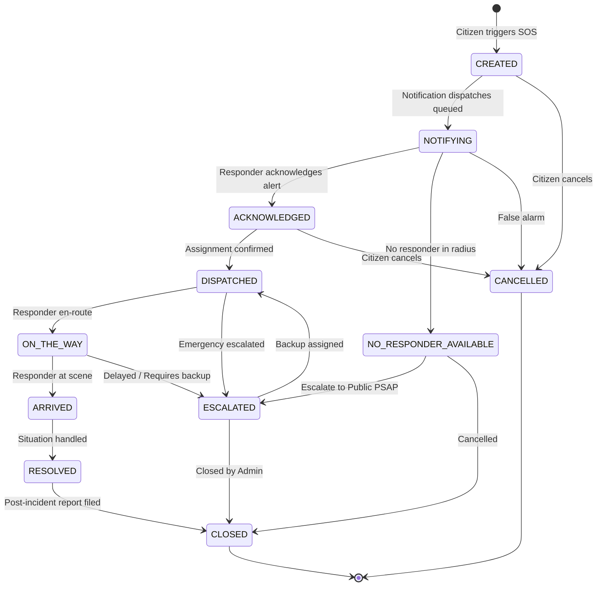

# Sentinel SOS — Architecture & System Design

## 1. High-Level System Overview

Sentinel SOS is an intelligent emergency-response management platform engineered for rapid citizen alert ingestion, automated responder candidate filtering, and real-time incident lifecycle management.

```
       +-------------------------------------------------------------+
       |               Citizen App / Responder App / Web             |
       +------------------------------+------------------------------+
                                      | HTTPS / WSS
                                      v
       +-------------------------------------------------------------+
       |             FastAPI Application Gateway                     |
       |  - JWT Authentication & RBAC (Citizen / Responder / Admin)  |
       |  - Input Validation (Pydantic V2)                           |
       |  - Idempotency & Rate Limiting                              |
       +-------------------+--------------------+--------------------+
                           |                    |
             +-------------+                    +-------------+
             v                                                v
+--------------------------+                     +---------------------------+
| PostgreSQL (Relational)  |                     |   MongoDB (Event Store)   |
| - Users & Roles          |                     | - sos_incidents           |
| - Responders & Badges    |                     | - sos_events (Audit Trail)|
| - Emergency Contacts     |                     | - location_history        |
| - Incident Assignments   |                     | - notification_attempts   |
+--------------------------+                     +---------------------------+
             |                                                |
             +-----------------------+------------------------+
                                     |
                                     v
                 +---------------------------------------+
                 |       External Integration Layer      |
                 |  - Google Maps (Geocode, Routes ETA)  |
                 |  - SMS (Mock / Twilio / MSG91)        |
                 |  - Push (Firebase Cloud Messaging)    |
                 |  - AI Triage Classifier (LLM Decision)|
                 +---------------------------------------+
```

## 2. Dual Database Strategy

| Storage Engine | Responsibility | Rationale |
| :--- | :--- | :--- |
| **PostgreSQL** | User identities, credential hashes, roles, responder telemetry status, emergency contact graphs, and transactional assignments. | ACID transactions, referential integrity, strong foreign-key constraints. |
| **MongoDB** | Emergency incidents, immutable chronological audit events (`sos_events`), responder tracking breadcrumbs, and notification attempt logs. | Schema flexibility, high-throughput append-only event streams, horizontal scaling. |

## 3. Incident State Machine



## 4. Responder Selection & Dispatch Logic

1. **Qualification Filter**: Confirms responder holds the required certification (e.g., `MEDICAL`, `FIRE`, `POLICE`, or `GENERAL`).
2. **Operational Status**: Confirms responder is marked `AVAILABLE` and `is_verified == True`.
3. **Preliminary Spatial Filter**: Evaluates straight-line Haversine distance between incident coordinates and responder's latest ping:
   $$\text{distance} \le \text{service\_radius\_km}$$
4. **Route ETA Calculation**: Queries Google Maps Directions/Routes for true road network driving time and distance.
5. **Transactional Lock**: Concurrency-protected assignment ensures no two responders can claim the same incident simultaneously.
